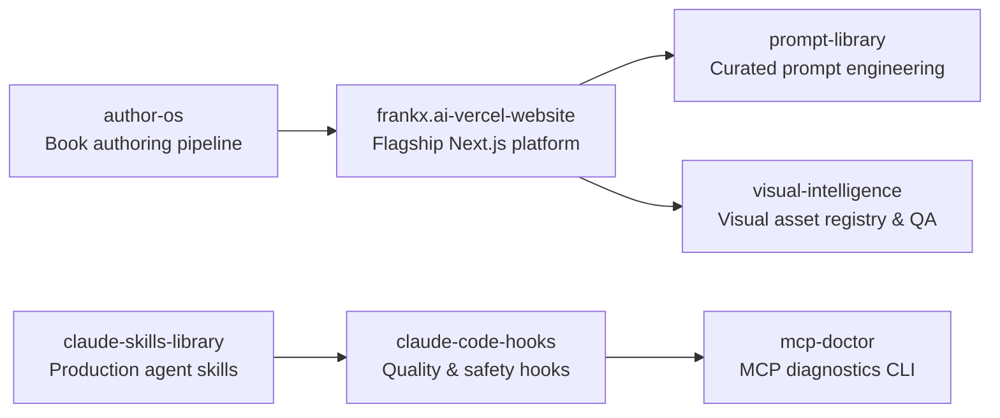

# FrankX

AI architecture, editorial publishing, prompt libraries, and developer tools by Frank Riemer.

**Website:** [frankx.ai](https://frankx.ai) · **Ecosystem:** [Starlight Intelligence](https://github.com/Starlight-Intelligence) · [Starlight Systems](https://github.com/Starlight-Intelligence-Systems) · [Arcanea Labs](https://github.com/Arcanea-Labs) · [GenCreator](https://github.com/GenCreator-ai) · [FrankX](https://github.com/FrankX-AI)

---

## Overview

FrankX is the flagship engineering and publishing hub of Frank Riemer: production Next.js web architecture, book authoring pipelines, Claude Code hooks, MCP diagnostics, and curated skill libraries.

## System topology



## Flagship repositories

| Repository | Purpose | Link |
| :--- | :--- | :--- |
| [**frankx.ai-vercel-website**](https://github.com/FrankX-AI/frankx.ai-vercel-website) | Public Next.js application powering frankx.ai: articles, architecture guides, books, and interactive tools. | [Website](https://frankx.ai) |
| [**claude-skills-library**](https://github.com/FrankX-AI/claude-skills-library) | Production agent skills for Claude Code, Codex, and skills-aware developer runtimes. | [Website](https://frankx.ai) |
| [**claude-code-hooks**](https://github.com/FrankX-AI/claude-code-hooks) | Quality, safety, and context-preservation hook system for Claude Code. | [Website](https://frankx.ai) |
| [**mcp-doctor**](https://github.com/FrankX-AI/mcp-doctor) | CLI tool to diagnose, benchmark, and repair Model Context Protocol server configurations. | [Website](https://frankx.ai) |
| [**author-os**](https://github.com/FrankX-AI/author-os) | AI-native book authoring and multi-format publishing system. | [Website](https://frankx.ai/books) |
| [**prompt-library**](https://github.com/FrankX-AI/prompt-library) | Versioned library of tested prompts for architecture, code review, and creative production. | [Website](https://frankx.ai/prompt-library) |
| [**visual-intelligence**](https://github.com/FrankX-AI/visual-intelligence) | Visual asset management, metadata indexing, and automated quality gates. | [Website](https://frankx.ai) |

## Quickstart

```bash
# Run MCP Doctor on your local agent configuration
npx mcp-doctor@latest check

# Clone the flagship frankx.ai web platform
git clone https://github.com/FrankX-AI/frankx.ai-vercel-website.git
```

## Engineering standards

Every repository in **FrankX** follows the Starlight estate engineering contract:

1. **Draft-first pull requests**: Open pull requests in draft mode (`gh pr create --draft`). CI workflows run only when a pull request is marked ready for review or lands on `main`.
2. **Independent verification**: Maker harness and Checker harness must differ (`Maker-Harness` != `Checker-Harness`).
3. **Zero committed secrets**: Credentials live in local environment files or Infisical. Pre-commit and CI gates reject secret patterns.
4. **Editorial clarity**: Public documentation uses sentence case headings, concrete verbs, and verified metrics.

---

<sub>Maintained by <a href="https://github.com/frankxai">Frank Riemer (frankxai)</a> · Built on the <a href="https://github.com/Starlight-Intelligence-Systems/Starlight-Intelligence-System">Starlight Intelligence Protocol (SIP)</a></sub>
